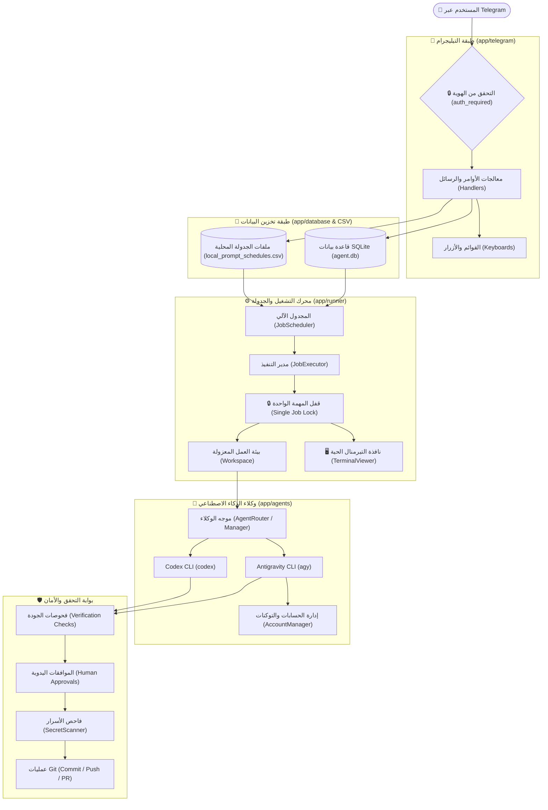

# 📖 دليل عمليات وهندسة النظام الشامل (System Operations Guide)
## Telegram Controller Bot for AI Coding Agents

---

## 📌 1. نظرة عامة على النظام (System Overview)

نظام **Telegram Controller Bot** هو محطة تحكم مركزية متقدمة تُدار عن بُعد عبر تطبيق تيليجرام (من الهاتف أو أي جهاز)، وتتيح تشغيل وتوجيه وكلاء البرمجة بالذكاء الاصطناعي (**Antigravity CLI** و **Codex CLI**) لتنفيذ المهام البرمجية على المشروعات المحلية (Local Projects) ومستودعات GitHub، مع إمكانية المراقبة المباشرة عبر نافذة تيرمنال حية على سطح المكتب.

### الأهداف الأساسية:
- **التحكم عن بُعد بدون الحاجة للبقاء أمام الحاسوب**: إعطاء التوجيهات، إرسال المهام، مراجعة الكود، والموافقة على التعديلات عبر الهاتف.
- **عزل الأمان والمشاريع**: كل مهمة تُنفذ في بيئة معزولة ومحمية، مع فحص صارم للأسرار والمفاتيح قبل أي عملية حفظ أو رفع.
- **التشغيل المجدول والفوري**: تشغيل المهام فوراً أو جدولتها لأوقات لاحقة.
- **التيرمنال المباشر (Live Terminal)**: فتح نافذة أوامر مرئية تلقائياً على سطح المكتب لمتابعة تقدم الوكيل لحظة بلحظة.

---

## 🏗️ 2. المخطط المعماري للنظام (System Architecture)



---

## 🔄 3. دورة حياة العمليات والمسارات الرئيسية (Detailed Operations)

### 🚀 العملية 1: تشغيل المهام على مستودعات GitHub (`/run` أو قائمة GitHub)
تُستخدم لتكليف الوكيل بحل Issue محدد في مستودع GitHub.
1. **الاختيار**: يختار المستخدم المستودع ثم رقم الـ Issue من خلال أزرار تيليجرام.
2. **الاستنساخ والعزل**: يقوم محرك `app/runner/workspace.py` باستنساخ أو تجهيز نسخة عمل معزولة خاصة بهذه المهمة.
3. **إنشاء الفرع**: إنشاء فرع Git معزول بالاسم النمطي `ai/issue-<issue_number>`.
4. **بناء السياق (Context Builder)**: استخراج تفاصيل الـ Issue من GitHub وتمريرها في إطار عمل آمن للوكيل.
5. **التشغيل المباشر والتيرمنال**:
   - إطلاق عملية الوكيل (`Antigravity` أو `Codex`).
   - تشغيل نافذة PowerShell مرئية على شاشة الحاسوب لمتابعة المخرجات مباشرة عبر `app/runner/terminal_viewer.py`.
6. **التحقق والأمان**:
   - تشغيل الفحوصات الآلية (`tests`, `ruff`, إلخ).
   - مسح الكود بحثاً عن أي مفاتيح مسربة عبر `SecretScanner`.
7. **الرفع والـ Pull Request**: إنشاء Commit ثم رفعه إلى GitHub وفتح Pull Request تلقائياً مع إشعار المستخدم بالرابط على تيليجرام.

---

### 📅 العملية 2: جدولة المهام المحلية والبرومبتات (`/schedule` أو المهام المجدولة)
تُستخدم لإرسال برومبت أو تعديل برمجي على أحد مشروعاتك المحلية المخزنة على الحاسوب.
1. **تحديد المشروع**: اختيار أحد المشروعات المحلية المحفوظة عبر القائمة.
2. **إدخال البرومبت (Prompt)**:
   - **كنص**: إرسال التعليمات البرمجية مباشرة في المحادثة.
   - **كصورة من الهاتف**: إرسال صورة أو سكرين شوت، حيث يقوم البوت بحفظها في مجلد `.agent_assets/` الخاص بالمشروع وتوجيه الوكيل لفحصها وتنفيذ المطلوب منها.
   - **كصورة مع شرح (Caption)**: دمج الشرح مع مسار الصورة تلقائياً.
3. **تحديد الوقت**:
   - `الآن`: تنفيذ فوري.
   - `بعد 15 دقيقة / ساعة / وقت مخصص`: جدولة في المستقبل.
   - `تاريخ ووقت محدد`: يتم تحويل التوقيت تلقائياً من توقيت جهاز المستخدم المحلي إلى توقيت UTC العالمي.
4. **حفظ البرومبتات في البوت فقط (دون تلويث المشروع)**:
   - تُخزن جميع البرومبتات والمهام المجدولة محلياً ومركزياً داخل مجلد عمل البوت الخاص به (`WORKSPACE_DIR/schedules/local_prompt_schedules.csv`) وليس داخل مجلد المشروع، مما يحافظ على نظافة مجلد مشروعك البرمجي تماماً دون إنشاء أي ملفات CSV دخيلة.
5. **التنفيذ التلقائي والإخفاء الفوري بعد التشغيل**:
   - يفحص `JobScheduler` كل 60 ثانية، وعند حلول الوقت يطلق `JobExecutor` لتنفيذ المهمة محلياً وعمل Commit للتغييرات.
   - **بمجرد تشغيل البرومبت واكتماله، يختفي تماماً وتلقائياً من قوائم البوت ولا يظهر لك مجدداً** حتى لا تتراكم البرومبتات القديمة وتظل فقط المهام المنتظرة التي لم تُنفذ بعد.

---

### 📋 العملية 3: إدارة المهام المجدولة (`/scheduled`)
تتيح مراجعة والتحكم في المهام المنتظرة فقط (البرومبتات المنفذة تختفي تلقائياً):
- **عرض التفاصيل**: استعراض نص المهمة، المشروع، والوقت المتبقي للمهام النشطة وغير المنفذة فقط.
- **التنفيذ الفوري (Start Now)**: بدء المهمة مباشرة دون انتظار حلول وقتها.
- **تعديل الوقت (Edit Time)**: تأجيل أو تقديم موعد التنفيذ.
- **الحذف والإلغاء (Delete)**: إزالة المهمة نهائياً من الجدولة.

---

### 🖥️ العملية 4: عارض التيرمنال المباشر على سطح المكتب (Live Terminal Viewer)
ميزة صُممت لتمنحك الشفافية الكاملة أثناء عمل الوكيل:
1. **الآلية التقنية**:
   - يولد النظام سكريبت PowerShell خاص بكل مهمة (`.agent_terminal_runner_<job_id>.ps1`).
   - تُفتح نافذة PowerShell جديدة ذات مظهر احترافي ومستقل على سطح المكتب.
   - يتم قراءة تدفق المخرجات عبر `System.IO.StreamReader` بنظام مشاركة الملفات (`FileShare.ReadWrite`) لقراءة السطور فور كتابتها دون إقفال الملف.
2. **نهاية التنفيذ**:
   - عند انتهاء الوكيل (سواء بنجاح أو توقف)، لا تُغلق النافذة فجأة، بل تُعرض رسالة ختامية واضحة (`[OK] AI Agent Finished` أو `[!] AI Agent Stopped`).
   - تظل النافذة مفتوحة للمراجعة وقراءة النتائج حتى تقوم بإغلاقها بنفسك أو انتهاء المؤقت التلقائي.

---

### 🔄 العملية 5: إدارة الحسابات المتعددة واستئناف العمل (`/accounts`)
حل مشكلة نفاد حدود الـ Tokens لحسابات Google Antigravity:
1. **استعراض الحسابات**: عرض الحساب النشط والحسابات الأخرى المحفوظة.
2. **التبديل الفوري**: التبديل لحساب آخر بضغطة زر وتحديث ملفات الجلسة (`Session Switch`).
3. **الاستئناف بعد نفاد الـ Tokens (Resume after Limit)**:
   - عند نفاد الـ Tokens أثناء عمل الوكيل، يكتشف النظام ذلك فوراً عبر `is_token_limit`.
   - يتم حفظ حالة المهمة بدقة في جدول `job_state`.
   - يرسل البوت إشعاراً للمستخدم بأن التوكنات نفدت.
   - يقوم المستخدم باختيار حساب آخر من `/accounts`، ثم يضغط زر **استئناف العمل**، ليكمل الوكيل مهمته من حيث توقف دون إعادة بناء الكود من الصفر!

---

### 📁 العملية 6: تصفح وإدارة المشاريع المحلية (`/projects` أو المشاريع المحلية)
- **مستعرض الأقراص (Drive Browser)**: واجهة مرئية على تيليجرام تتيح لك التنقل بين الأقراص (`C:\`, `D:\`) والمجلدات واختيار مسار أي مشروع.
- **تأكيد الحفظ**: لا يتم حفظ المشروع إلا بعد الضغط على زر **تأكيد واختيار المشروع** لمنع إضافة أي مجلد بالخطأ.
- **المشاريع المحفوظة (`saved_projects`)**: سهولة الوصول لمشاريعك المفضلة وتعيين أسماء سهلة لها.

---

### 🛑 العملية 7: الاستئناف عند إعادة التشغيل والتعافي (Crash Recovery)
- عند تشغيل البوت (أو بعد إعادة تشغيل الجهاز)، يقوم `RecoveryService` بفحص قاعدة البيانات.
- إذا كانت هناك مهمة نشطة وتوقفت فجأة بسبب انقطاع الكهرباء أو إعادة التشغيل، يُحدد البوت إمكانية استئنافها ويُرسل لك خيار استئنافها مباشرة.

---

### 🔒 العملية 8: الوضع الشخصي الآمن (Personal Mode)
- وضع اختياري لإدارة ملفات السيرفر وتنفيذ بعض الأوامر الإدارية (`ls`, `ps`, `pkill`).
- **مفتاح الأمان باتجاه واحد (One-Way Safety Switch)**:
  - عند تعطيل الوضع الشخصي، يُنشئ النظام ملف قفل دائم (`.personal_mode_disabled`).
  - لا يمكن إعادة تفعيله من خلال تيليجرام مطلقاً؛ بل يتطلب وصولاً مادياً مباشراً للسيرفر وتشغيل:
    ```bash
    py -m app.main --enable-personal
    ```

---

### 📊 العملية 9: مراقبة حالة الجهاز والمهام (`/status` و `/stop`)
- **`/status`**: يعرض المهمة النشطة حالياً، وقت البدء، ونسبة إنجازها، بالإضافة إلى استهلاك المعالج والذاكرة والمساحة المتوفرة.
- **`/stop`**: يرسل إشارة إيقاف آمنة للوكيل الجاري، ويقوم بقتل العمليات التابعة له (`subprocesses`) وتنظيف الفروع والبيئة المؤقتة دون إتلاف أي ملفات.

---

## 🛡️ 4. ثوابت الأمان الصارمة في النظام (Safety Invariants)

| الثابت الأمني | الوصف | آلية الإنفاذ |
|---|---|---|
| **مستخدم واحد مصرح له** | البوت يتجاهل تماماً أي شخص غير المعرف المحدد | يتم التحقق عبر الديكوريتور `@auth_required` مع `TELEGRAM_ALLOWED_USER_ID` |
| **مهمة واحدة نشطة (Single Job)** | لا يمكن تشغيل مهمتين في نفس اللحظة لمنع تعارض وتلف الكود | قفل `JobExecutor._start_lock` يُلقي استثناء إذا كان هناك عمل قيد التنفيذ |
| **حظر الدفع للفروع الرئيسية** | الوكيل لا يدفع الكود أبداً لفرع `main` أو `master` | يتم العمل دائماً في فروع مستقلة مثل `ai/issue-<id>` |
| **فحص الأسرار الإجباري** | منع رفع أي API Keys أو Tokens أو كلمات مرور | فحص `SecretScanner` يفحص كل Commit قبل الرفع إلى GitHub |
| **إخفاء التوكنات في السجلات** | حجب كافة البيانات الحساسة من الظهور | معالج `app/utils/logging.py` يقوم بعمل Masking لجميع المفاتيح |

---

## 💻 5. أهم أوامر سطر الأوامر والصيانة (Developer & CLI Reference)

```powershell
# تشغيل البوت في الوضع العادي
py -m app.main

# تشغيل البوت مع التحديث التلقائي أثناء التطوير
py -m app.main --reload

# فحص صحة الإعدادات وملف .env
py -m app.main --check-config

# تشغيل حزمة الاختبارات الشاملة (365 اختبار)
py -m pytest

# فحص جودة وتنسيق الكود
py -m ruff check .

# فحص صحة الأنواع البرمجية (Types)
py -m mypy app

# فحص تسريب الأسرار في المستودع
py scripts/ci_check_secrets.py

# التحقق من سلامة وصلاحية مهارات الوكلاء (Skills)
py .agents/skills/skill-maintainer/scripts/validate_skills.py
```

---
*تم إنشاء هذا الدليل ليكون مرجعاً معمارياً وتشغيلياً دائماً لكافة عمليات وإجراءات النظام.*

